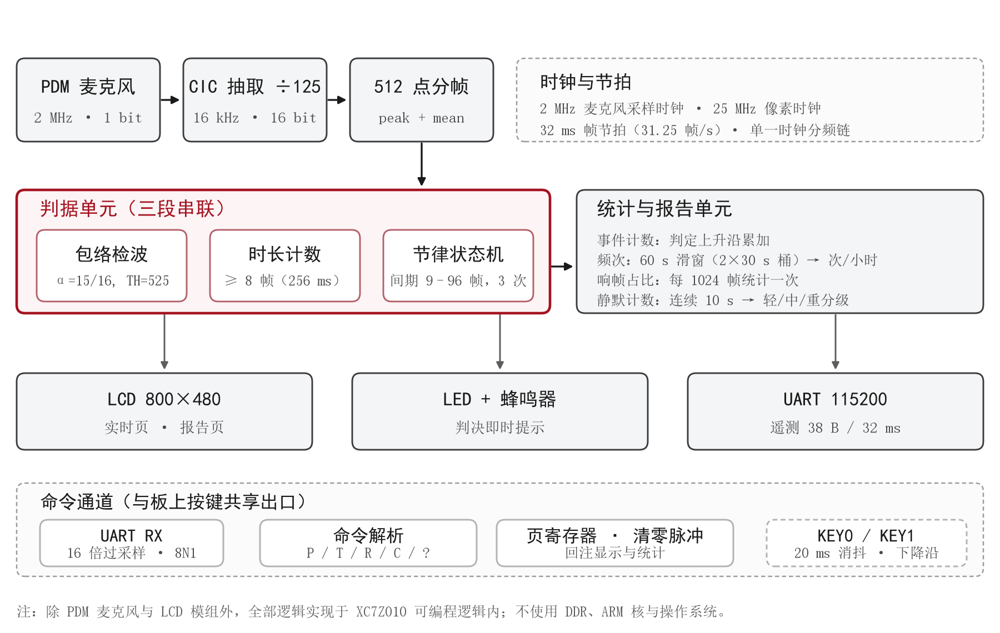
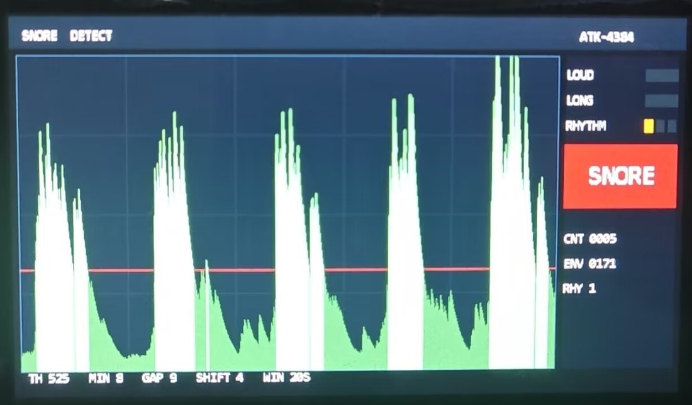

# 呼噜声检测 · FPGA 实时识别与健康筛查

在床头放一块 ZYNQ 开发板，接一根米粒大的数字麦克风。板子每秒听 16000 次，
判断"这一段像不像打呼噜"，把过程画在 4.3 寸屏上，同时给一份简略的睡眠小结。

全部逻辑跑在 PL 里，不依赖 ARM 核，不存文件、不联网，上电就工作。



> **EN** ｜ A pure-PL snore detector on ZYNQ-7010: PDM mic → CIC decimation →
> three-criteria time-domain decision (amplitude / duration / rhythm) → 800×480 dual-page UI.
> No DDR, no ARM core, no cloud; every threshold is interpretable and field-calibratable.

| 项目 | 内容 |
|---|---|
| 开发板 | 正点原子 领航者 ZYNQ7010（ATK-DF7010P / XC7Z010CLG400-1 / 底板 V3.9） |
| 工具 | Vivado 2018.3 |
| 麦克风 | Adafruit P3492（Knowles **SPH0641LM4H-1**，PDM 输出，2MHz） |
| 屏幕 | 正点原子 ATK-4384，4.3 寸 800×480，RGB565（**不带触摸**） |
| 时钟 | 系统 50MHz；像素 25MHz（二分频） |

---

## 0. 现在能做什么

| 能力 | 状态 | 证据 |
|---|---|---|
| PDM→PCM 采集（16kHz/16bit） | 通过 | 仿真注入 300Hz 正弦，CIC 输出实测 300.054Hz、幅度偏差 1.06% |
| 三条件鼾声判据 | 通过 | `tb_judge` 10 个场景全 PASS（含拍手、说话、风扇、慢呼吸、断链） |
| 串口遥测（38 字节/32ms） | 通过 | 上板帧号连续，静音 0 误判 |
| LCD 实时页 + 报告页 | 通过 | `tb_disp` 5 张图逐像素核对，时序 25MHz/1056×525/45.1Hz |
| 按键切页 / 清零 | 通过 | 上板实测 |
| **串口命令切页 / 清零** | 通过 | 上板实测：`?`/`P`/`T`/`R`/`C` 六次命令，`G` 字段逐次回执 `0→1→A→3→C→D→E`，页号与计数全部对得上；`tb_rx` 25 项全 PASS |
| 综合实现 | 通过 | 2424 LUT (13.8%) / 1253 FF (3.6%) / 0 BRAM / 0 DSP，WNS +7.773ns、WHS +0.034ns |
| 上板分段测试（v4） | 6/6 段 | 准备 / 安静 / 合成说话 / 拍手 / 鼾声 / 收尾 全部符合预期，鼾声段判出 4 次；鼾声刺激需 `--gain 8`（见 8.3） |

> 串口命令这一路是 2026-10-29 新增的，比特流已重新生成并**下载验证**（`out/snore_top.bit`）。
> 回执方式：遥测帧末尾的 `G` 字段 4 位十六进制 = `{bit3: 页号, bit2..0: 命令计数}`。
> 发完命令看这个数变没变，就知道板子收到没有；如果一直不变，先去查 CH340 的跳线是否在 PL 侧。

---

## 0.1 克隆与三步复现

```bash
git clone https://github.com/himawari422/zynq7010-snore-detect.git
cd zynq7010-snore-detect

# ① 综合出比特流（工作目录挑个可写的，别在 C:\ 根下跑）
vivado -mode batch -source scripts/build.tcl -tclargs C:/snore_build impl
cp C:/snore_build/snore_pdm.runs/impl_1/snore_top.bit out/

# ② 下载（板子上电、JTAG 接好；JTAG 热重配，不用断电）
vivado -mode batch -source scripts/program.tcl

# ③ 验证：帧尾应有 G 字段，发 '?' 后命令计数 +1
python scripts/snore_ctl.py --probe
```

不想自己综合的，直接用仓库里已验证过的 `out/snore_top.bit`（Vivado 2018.3 / xc7z010clg400-1）。

依赖：Vivado 2018.3；Python 3.8+（`pyserial`、`numpy`，控制台只用标准库）。

---

## 1. 硬件连接

### 1.1 麦克风（J3 扩展口，一根排线的距离）

| 麦克风焊盘 | 接到 | 板上网络 | FPGA 管脚 |
|---|---|---|---|
| **3V** | J3 第 38 脚 | +3.3V | — |
| **GND** | J3 第 37 或 39 脚 | GND | — |
| **CLK** | J3 第 20 脚 | LCD_B0 | **W18**（输出） |
| **DAT** | J3 第 19 脚 | LCD_B1 | **W19**（输入） |
| **SEL** | 和 GND 一起接 J3 第 37 脚 | GND | — |

三点必须注意：

1. **SEL 必须接地**。接 GND 时数据在 CLK 上升沿有效（左声道），接 3.3V 就变成下降沿，读出来全错。
2. **J3-19/20 就是 RGB LCD 的蓝色最低两位**。插着屏也一样能用，不冲突：
   屏侧 B0/B1 是输入，W18 是输出、W19 是输入，不存在两个输出对打。
   代价只有蓝色最低两位带 2MHz 抖动（占量程 0.8%），而本设计用 RGB565，B0/B1 本来就不用。
3. 模块旁边加 **1~10µF + 100nF** 到 GND，PDM 麦克风对电源噪声敏感。

### 1.2 屏幕

ATK-4384 直接插在 40PIN FPC 座上。约束里 `lcd_rgb` 声明成 `[23:2]`，
**最低两位故意不存在**，这样 Vivado 不可能把 LCD 的 B0/B1 分到 W18/W19 去和麦克风抢线。

### 1.3 串口（双向）

板上 CH340 的跳线必须接到 PL 侧，丝印写的是 **"PL UART: Connect 3&5 4&6"**。

| 方向 | FPGA 管脚 | 用途 |
|---|---|---|
| 板 → 电脑 | **J15** | 每 32ms 一行 38 字节遥测 |
| 电脑 → 板 | **T19** | 单字符命令（切页 / 清零 / 探活） |

> 别和 `PL_UART(RS232)/RS485` 那组的 K14/M15 弄混 —— 那组走 DB9，板载 USB 口接不到。

### 1.4 板上按键（屏幕外的两颗物理键）

| 键 | 管脚 | 作用 |
|---|---|---|
| `key[0]` | **L14** | 切换"实时页 / 报告页" |
| `key[1]` | **K16** | 清零统计 |

低电平有效，内部上拉，软件消抖 21ms。**屏幕不带触摸，所以屏幕上点不动，只能按这两颗键**（或者用电脑发命令）。

---

## 2. 目录结构

```
snore_pdm/
├── rtl/
│   ├── snore_top.v        顶层：例化全部子模块，唯一对外接口
│   ├── pdm_clk_gen.v      50MHz -> 2MHz PDM 时钟 + 采样点定位
│   ├── pdm_cic.v          4 阶 CIC，125 抽取，2MHz/1bit -> 16kHz/16bit
│   ├── frame_meter.v      512 点分帧，算峰值与平均绝对值
│   ├── snore_judge.v      ★ 三条件判据（包络 / 时长 / 节律）
│   ├── snore_report.v     ★ 统计与三档评级（免除法器）
│   ├── snore_display.v    ★ 双页渲染，无帧缓存
│   ├── lcd_timing.v       800×480 行场时序
│   ├── font_rom.v         8×16 点阵（脚本生成，勿手改）
│   ├── text_layer.v       实时页静态文字（脚本生成）
│   ├── text_layer_report.v 报告页静态文字（脚本生成）
│   ├── uart_tx.v          115200 8N1 发送
│   ├── uart_rx.v          ★ 115200 8N1 接收
│   ├── cmd_parse.v        ★ 单字符命令解析
│   └── uart_report.v      遥测帧格式化
├── deprecated/alarm_ctrl.v  已停用，仅作参考（不参与编译）
├── constr/snore_pdm.xdc   引脚与时钟约束
├── tb/
│   ├── tb_snore.v         PDM 激励 + 串口解码自检
│   ├── tb_judge.v         判据 10 个场景
│   ├── tb_disp.v          LCD 时序 + 5 张渲染图
│   └── tb_rx.v            ★ 串口接收与命令分发
├── scripts/
│   ├── build.tcl          一键建工程 / 仿真 / 综合 / 出比特流
│   ├── program.tcl        ★ 命令行下载比特流（不用开 GUI）
│   ├── snore_test.py      6 段引导式分段测试（人工配合）
│   ├── auto_test.py       ★ 6 段无人值守测试（电脑当声源）
│   ├── snore_ctl.py       ★ 电脑端控制台（网页界面 + 命令行）
│   ├── tune.py            判据参数网格搜索（RTL 的等价 Python 实现）
│   ├── calib.py           门限标定
│   ├── snore_mon.py       串口监看 / CSV 记录
│   ├── gen_lcd_assets.py  生成字库与文字层
│   ├── plot_snore.py      串口实时画图
│   └── verify_sim.py      仿真结果 FFT 校验
├── out/snore_top.bit      已生成的比特流
└── 测试.bat / 切换界面.bat / 调参.bat / 标定.bat
```

---

## 3. 信号链：从空气振动到屏幕上的一个点

**① 麦克风**。SPH0641 输出的是 1 位 PDM：1 表示"比上一刻响"，0 表示"比上一刻轻"，
靠 1 的密度表达幅度。板子给它 2MHz 时钟，每个上升沿吐一位。

**② CIC 抽取**。把连续 125 个 bit 累加（相当于低通 + 降速），得到 16kHz 的 16 位样本。
1024 倍过采样，4 阶，通带下垂在 300Hz 处仅 0.2%，所以不加补偿 FIR。
积分器溢出是**模运算，不是 bug**（Hogenauer 的经典结论），差分后结果仍正确。

**③ 分帧**。512 点 = 32ms 一帧，每帧只留两个数：`peak`（帧内最大绝对值）、
`mean_abs`（帧内平均值）。判据只吃 `peak`。

**④ 判据**。见下一节。

**⑤ 输出**。判据结果分四路：板载 LED / 蜂鸣器、串口遥测、LCD 实时页、LCD 报告页。

---

## 4. 判据：为什么不"够响就算"

只比响度，风噪、说话、关门、吹风机全会触发。鼾声真正区别于其它声音的是三件事，
必须**同时**成立：

### ① 够响 —— 峰值包络检波

不是拿单帧 peak 比门限，而是先做包络跟踪：

```
peak >= env  ->  env = peak            快起：起始点不失真
peak <  env  ->  env -= env >> 4       慢落：每帧衰减 1/16，常约 0.5 秒
```

为什么要包络：实测发现相邻的高电平段间隔大多只有 1~6 帧（32~192ms），
直接按单帧切分会把一次连续发声切成十几块碎片，每块都太短，"够长"永远不成立。
包络把 300ms 以内的间隙填平，而真正的呼吸间隔（≥0.5s）依然会被切开。

### ② 够长 —— 数的是原始超阈帧数

一次有效声事件，`peak > TH` 的帧数必须 ≥ 8 帧（256ms）。

这里有个坑曾经踩过：包络的"慢落"会把 4 帧（128ms）的咔哒声拉长到 25 帧，
如果拿包络长度去判"够长"，短促声就会被蒙混过关。
所以长度必须数 `raw_cnt`（原始峰值直接超阈的帧数），包络只负责"切分"，不负责"计长"。

### ③ 有节律 —— 间隔落在 288ms ~ 3s

两次声事件之间的静音间隔必须落在这个窗口内，并且连续满足 3 次才最终判决。

这是最有效的一条。实测标定的关键发现是：
**说话和鼾声的响度几乎无法区分**（说话段包络 p90=759，鼾声段 p90=855），
真正能分开的是**间隔尺度**：

| | 一次持续 | 间隔 |
|---|---|---|
| 说话 | 音节 0.2~0.4s | 音节间隙 50~300ms，句子间 0.3~1s |
| 鼾声 | 1.5~2s | 2~3s |

所以 `GAP_MIN = 9 帧（288ms）` 是压制说话误报的主力，抬门限只是辅助。

### 附带的好处

持续稳定的强噪声（风扇、吹风机、白噪声）永远不会"结束"，
一次有效 burst 都凑不齐，天然不会误报 —— 不需要额外写规则去挡它。

### 参数表

| 参数 | 值 | 含义 |
|---|---|---|
| `TH` | 525 | 包络门限（2026-10-28 真人实测标定） |
| `ENV_SHIFT` | 4 | 包络释放时间常数 512ms |
| `MIN_ON_F` | 8 | 最短有效发声 256ms |
| `GAP_MIN_F` | 9 | 节律间隔下限 288ms |
| `GAP_MAX_F` | 96 | 节律间隔上限 3072ms |
| `N_PERIOD` | 3 | 连续 3 次节律才判决 |
| `HOLD_F` | 32 | 判决后指示灯保持 1s |
| `BEEP_F` | 7 | 蜂鸣 224ms |

判据同时把中间量送到串口（包络 `E`、burst 长度 `C`、节律计数 `R`、状态位 `S`），
任何一次误判/漏判都能一眼看出是哪一条卡住了。

---

## 5. 屏幕：两页

### 实时页（`key[0]` 或命令 `T`）

```
┌────────────────────────────────┬──────────────┐
│ 滚动包络波形（20 秒窗口）        │ LOUD    [灯] │ ← 判据①
│ 红色虚线 = 门限 TH               │ LONG    [灯] │ ← 判据②
│ 过门限的部分画成亮绿             │ RHYTHM  ○○○ │ ← 判据③
│                                 │  ┌────────┐  │
│                                 │  │ SNORE  │  │ ← 判决结果
│                                 │  └────────┘  │
│                                 │ CNT 0000     │
│                                 │ ENV 0A3C     │
└────────────────────────────────┴──────────────┘
 底部：TH 525  MIN 8  GAP 9  SHIFT 4  WIN 20S
```

**没有帧缓存**：800×480×16bit = 768KB，而 XC7Z010 全部 BRAM 只有 264KB，装不下。
所以不存画面，只存 1024 个 12bit 的包络历史（1.5KB），每个像素的颜色由坐标当场算出来。

实拍（本例三条判据同时成立，判决区亮起 `SNORE`，`CNT` 已累计 85 次）：



### 报告页（`key[0]` 或命令 `R`）

```
SNORE  REPORT                        ATK-4384
 EVENTS   0000        累计判决次数
 RATE /H  0180        每小时次数（两个 30 秒桶拼 1 分钟滑窗 ×60）
 SNORE %  38          超阈帧占比（1024 帧一块）
 SILENCE  02          疑似静默次数
 LEVEL  [██████████░░░░░░░░░░]         MID
 MODERATE: TRY SLEEPING ON YOUR SIDE.
 KEEP THE ROOM HUMID, AVOID ALCOHOL.
 SCREENING ONLY - NOT A MEDICAL DIAGNOSIS.
```

- **RATE**：`(上桶 + 本桶) × 60`。×60 写成 `(x<<6)-(x<<2)`，一个减法器，不占 DSP。
- **SNORE %**：`(响帧×100)>>10`，×100 写成 `<<6+<<5+<<2`，1024 是 2 的幂所以除以 1024 是移位。
- **SILENCE**：有过鼾声之后，连续 10 秒没有新判决记一次，恢复前不重复计。
  麦克风只能听声音、测不到气流，所以**不能叫呼吸暂停**，屏幕和文档一律写"疑似静默"。
- **LEVEL**：按每小时次数 120 / 400 分三档，若出现疑似静默则至少抬到中等、3 次抬到偏重。
  三档建议文案都写在文字层里（17/18、20/21、23/24 行），显示时把行号加 `3*level` 再查表，
  三档都落在同一位置，不会上下跳。
- 开机不满 1 分钟（两个 30 秒桶没走完）显示 **WAIT**，不拿几分钟的数据下结论。

> 屏幕措辞刻意避开"健康评分""AHI"，全部写"筛查提示，非医学诊断"。

---

## 6. 两种控制方式

板上两颗键和电脑命令**操作的是同一个页面寄存器**，所以完全等价，随便用哪个。

### 6.1 板上按键

| 键 | 作用 |
|---|---|
| `key[0]`（L14） | 切页 |
| `key[1]`（K16） | 清零统计 |

### 6.2 电脑 / 串口助手（v4 新增）

串口助手（115200 8N1）里直接敲一个字母就行，不需要任何上位机：

| 字符 | 作用 |
|---|---|
| `P` / `p` | 翻转页面 |
| `T` / `t` / `0` | 切到实时页 |
| `R` / `r` / `1` | 切到报告页 |
| `C` / `c` | 清零统计（等同 `key[1]`） |
| `?` / `h` / `H` | 探活：不改任何状态，只让命令计数 +1 |

其它任何字节（含回车换行、乱码）一律静默丢弃，不会误动作。

**板上会回执**：遥测帧末尾的 `G` 字段里带"命令计数"，
每收到一条合法命令就 +1（3 位循环）。上位机发完看一眼这个数变没变，
就知道板子到底收没收到，不用伸头去看屏幕。

---

## 7. 串口协议

每 32ms 输出一行，固定 **38 字节**（含 `\r\n`）：

```
F0012 P01F4 A0033 E02A1 S9 C0E R2 G0
```

| 字段 | 含义 |
|---|---|
| `F` | 帧序号，4 位十六进制，会回绕 |
| `P` | 一帧内 \|pcm\| 的峰值 |
| `A` | 一帧内 \|pcm\| 的平均值 |
| `E` | 响度包络（与屏幕上的 ENV 一致） |
| `S` | 判据状态位，1 位十六进制：bit0 响 / bit1 够长 / bit2 判为鼾声 / bit3 进入节律链 |
| `C` | 当前 burst 内原始超阈帧数（`MIN_ON` 判的就是它） |
| `R` | 已积累的节律次数 |
| `G` | 页面回显：bit3 = 当前页（0 实时 / 1 报告），bit2..0 = 命令计数 |

一点说明：六个字段在顶层统一延迟了一拍再送串口（把 `mean_abs → f_ma`
那条 0 级逻辑直连的长线切成两段，改善保持时间）。
所以每行内部各字段仍然严格同帧，只是整条遥测比屏幕上看到的状态晚 32ms —— 对人眼没有区别。

**为什么用十六进制**：PL 里做十进制转换要么加除法器要么加状态机，十六进制只是查表，零成本。

---

## 8. 电脑端工具

### 8.1 `切换界面.bat` —— 网页控制台（推荐）

双击即可。脚本会起一个只监听 `127.0.0.1:8765` 的小服务并自动打开浏览器，
页面里：

- 顶部选 COM 口，点"连接"
- 四个大按钮：**实时页 / 报告页 / 切换页面 / 清零统计**
- 点完按钮会显示"✔ 已确认"，这个确认是板子回执的，不是猜的
- 中间实时显示：当前页、包络条（带门限刻线）、四个判据灯、判决累计
- 下方是最近 19 秒的包络曲线，鼾声判决段用红框标出

> 为什么界面开在浏览器里而不是 tkinter：这台机器上的 Python 是便携版，
> 没带 tkinter（`import tkinter` 直接报 ModuleNotFoundError）。
> 用标准库 `http.server` 起本地服务 + HTML 页面，零额外依赖，
> 也不用为了一个按钮去装一整套 Python 发行版。
> 不想自动开浏览器就加 `--no-browser`，自己访问终端上打印的地址。
> 不带参数就开图形界面；不给端口会自动挑 CH340/CP210x 那个。

### 8.2 命令行（写批处理 / 远程用）

```bash
python scripts/snore_ctl.py COM7 --page report   # 切到报告页
python scripts/snore_ctl.py COM7 --page rt       # 切到实时页
python scripts/snore_ctl.py COM7 --page toggle   # 翻转
python scripts/snore_ctl.py COM7 --clr           # 清零
python scripts/snore_ctl.py COM7 --probe         # 探活
python scripts/snore_ctl.py COM7 --cmd P         # 直接发字符
```

### 8.3 `自动测试.bat` —— 无人值守分段测试

和 `测试.bat` 的区别：那个要你亲手放音、亲手说话、亲手拍手；
这个由电脑自己当声源，你只要确认板子上电、串口通，等 102 秒拿结果。

```bash
python scripts/auto_test.py COM7                 # 完整 102 秒，六段
python scripts/auto_test.py COM7 --fast          # 缩短版约 60 秒
python scripts/auto_test.py COM7 --only snore    # 只跑鼾声段（48 秒）
python scripts/auto_test.py COM7 --only snore --gain 4   # 响度压缩 4 倍再跑
```

六段的刺激来源：

| 段 | 刺激 | 用意 |
|---|---|---|
| 准备 / 基线安静 / 收尾安静 | 无声 | 确认零误判 |
| 合成说话 | 共振峰合成的音节性语声（F0≈115Hz，音节率≈4.2Hz） | 压"够长"和"有节律"两条 |
| 拍手 1Hz | 28ms 宽带瞬态 | 每下只占 1 帧，远不到 MIN_ON=8 |
| 鼾声 | `snore_stim.wav` 原样 | 应该判出鼾声 |

**一个必须知道的坑**：`snore_stim.wav` 是低频为主的（85% 能量在 400Hz 以下，
最强频点 218Hz）。笔记本扬声器放不出 200Hz 以下，所以数字峰值 0.73 的录音，
到麦克风那里比同峰值的 800Hz 纯音低 **10dB 以上**，很容易弱到判不出来。
这不是固件问题。解决办法按优劣排序：

1. 用手机放（手机腔体虽小，但比笔记本扬声器强得多，且可以贴到麦克风旁边）
2. 把板子挪到喇叭 10~15cm 内
3. 加 `--gain 3`~`4` 做响度压缩（峰值不削顶，2 秒响 / 2 秒静的包络不变）

判断刺激够没够，看输出里的 `E_max` 和 `持续%`，实测三档很清楚：

| 刺激 | E_max | 持续% | 最长 burst | 节律 | 判决 |
|---|---|---|---|---|---|
| 原样（gain 1） | 870~1910 | 1~3% | 10~21 帧 | 1~2 | 0 |
| gain 4 | 1819 | 13% | 21 帧 | 2 | 0 |
| gain 8 | 946~2327 | 12~18% | 28~29 帧 | **3** | **4~5** |

**注意不是"峰值越大越好"，是"超阈要连得上"**。gain 4 那次 E_max 有 1819，
但包络一直贴着门限 525 上下抖：27 个间隙里 10 个只有 1~5 帧（噪声性抖动，
构不成事件），另外 3 个是 97/115/120 帧（超过 GAP_MAX 的 96 帧）。
最可惜的一次在 t=10.24s：节律已经涨到 2，下一个间隙 97 帧，只比上限多 1 帧，
整条链被清零。gain 8 之后包络彻底抬离门限，burst 连成 28 帧、间隙稳定在 1.3~1.8s，
节律才第一次走满 3 次。

所以测试判 [NG] 时，先看 `E_max` 有没有到 1500、`持续%` 有没有到 10%，
再怀疑判据。

### 8.4 其它脚本

| 脚本 | 入口 | 干什么 |
|---|---|---|
| `snore_test.py` | `测试.bat` | 6 段引导测试（准备/安静/说话/拍手/鼾声/收尾），逐段给 [OK]/[NG] |
| `auto_test.py` | `自动测试.bat` | 同样 6 段，但由电脑自己产生刺激，无人值守 |
| `tune.py` | `调参.bat` | 用采到的 CSV 把判据在 PC 上重跑，网格搜索最优参数 |
| `calib.py` | `标定.bat` | 量环境噪声底，反推 `TH` 该取多少 |
| `snore_mon.py` | 命令行 | 抓几秒串口打印统计，可存 CSV |

几个 `.bat` 都是纯 ASCII + CRLF、自动探测 Python 路径，双击就能跑。

---

## 9. 资源与时序（Vivado 2018.3，xc7z010clg400-1）

| 资源 | 用量 | 占比 |
|---|---|---|
| Slice LUTs | 2424 | 13.8% |
| └ LUT as Logic | 2168 | 12.3% |
| └ LUT as Memory | 256 | 4.3% |
| Slice Registers | 1253 | 3.6% |
| Block RAM | 0 | 0% |
| DSP | 0 | 0% |

时序（`reports/timing_impl.rpt`）：**WNS +7.773ns，WHS +0.034ns**，无失败端点。

最差保持路径不在本设计的主体逻辑上，而是 CIC 积分器里两个相邻寄存器之间的一条进位链
（`u_cic/i2_reg[1] → u_cic/i3_reg[2]`，一级 CARRY4，数据 0.41ns）。
它薄的原因是**时钟偏斜**（DCD 2.03ns − SCD 1.51ns = 0.52ns）几乎吃掉了整个数据延迟，
不是逻辑太深。这条路径仍然是 MET，且积分器每 25 拍才更新一次、本身是模运算，
即使真出问题也只影响一个采样点的精度，所以没有为它额外插流水。

三个曾经踩过的坑，记在这里省得下次再踩：

1. **小容量历史缓冲别塞进带复位的 always**。1024×12bit 那样写，
   Vivado 不会推断成 RAM，而是生成 12288 个触发器 + 一棵 1024:1 的异步读多路树，
   实测 6658 LUT / 13640 FF。改成"写一个 always、读连续赋值 + `ram_style="distributed"`"
   之后降到 2370 LUT / 1128 FF，画面逐像素完全一致。
2. **FF→FF 的长线也会违例**。`mean_abs` 到 `f_ma` 是 0 级逻辑直连，
   布得远时保持余量只剩 12ps。在顶层插一级上报流水把线切成两段之后，
   这条路径已经不在最差名单里（清单里最差的变成了上面那条 CIC 进位链）。
3. **跨时钟域的单拍脉冲会被漏采**。清零命令是 50MHz 域的一拍（20ns），
   直接送进 25MHz 的显示域有一半概率采不到。必须先转成"翻转电平"再同步检边沿。

---

## 10. 常用操作

### 10.1 下载比特流

**方式一：命令行（推荐，不开 GUI）**

```bash
vivado -mode batch -source scripts/program.tcl
# 工作目录要挑个可写的，别在 C:\ 根目录下跑（Vivado 要在那里写 vivado.log）
```

脚本会自动连本地 hw_server、认出 `xc7z010_1`、把 `out/snore_top.bit` 烧进去。
成功标志是日志里出现：

```
INFO: [Labtools 27-3164] End of startup status: HIGH
PROGRAM_DONE: OK
```

**方式二：GUI**

```
Vivado -> Open Hardware Manager -> Auto Connect -> Program Device -> 选 out/snore_top.bit
```

**三点提醒**

1. **不用断电、不用拔线**。JTAG 是热重配，直接覆盖当前比特流。
   重配瞬间屏幕会黑一下再重绘、串口帧号从 `F0000` 重开，都是正常的。
2. 下载前最好关掉串口程序和 `切换界面.bat` 的后台服务，免得把重配瞬间的乱码当帧解析。
3. 这是**下载到 PL**，掉电即失效。要开机自动跑，得把 bit 转 `.mcs` 烧 QSPI Flash，本工程没做。

如果只是想重新统计而不换固件，按板上 `K16` 清零即可，不用动 JTAG。

### 10.1.1 验证新固件是否真的在跑

```bash
# 帧尾应该有 G 字段（老固件没有）；发 '?' 后 G 的命令计数应该 +1
python scripts/snore_ctl.py COM7 --probe
```

### 10.2 跑仿真

```bash
vivado -mode batch -source scripts/build.tcl -tclargs C:/snore_build sim    # 采集链路
vivado -mode batch -source scripts/build.tcl -tclargs C:/snore_build judge  # 判据 10 场景
vivado -mode batch -source scripts/build.tcl -tclargs C:/snore_build disp   # LCD 5 张图
vivado -mode batch -source scripts/build.tcl -tclargs C:/snore_build rx     # 串口命令
```

重新出比特流（改了 RTL 之后）：

```bash
vivado -mode batch -source scripts/build.tcl -tclargs C:/snore_build impl
# 产物在 C:/snore_build/snore_pdm.runs/impl_1/snore_top.bit，记得拷到 out/ 再下载
```

### 10.3 重新生成文字层

改了屏幕文案就重跑：

```bash
python scripts/gen_lcd_assets.py
```

字库和两套文字层都由它生成，改文案只改脚本里的 `TEXT` / `TEXT_REPORT` 表。

---

## 11. 参数速查

| 参数 | 位置 | 默认 | 说明 |
|---|---|---|---|
| `DIV_HIGH/LOW` | pdm_clk_gen.v | 12/13 | 25 分频得 2MHz，占空比 48% |
| `SMP_AT` | pdm_clk_gen.v | 15 | 采样点距上升沿约 340ns，**窗口只有 500ns，别乱改** |
| `R` | snore_top.v → pdm_cic | 125 | 2MHz/125 = 16.000kHz |
| `OUT_SHIFT` | snore_top.v → pdm_cic | 13 | 右移位数，每减 1 = +6dB |
| `FRAME_LEN` | snore_top.v → frame_meter | 512 | 32ms 一帧，必须是 2 的幂 |
| `TH` 等 7 个 | snore_top.v → snore_judge | 见第 4 节 | 判据参数 |
| `FRAMES_PER_BUCKET` | snore_report.v | 937 | 29.98s 一个桶 |
| `SIL_LIM` | snore_report.v | 313 | 10.0s 算疑似静默 |

---

## 12. 故障排查

| 现象 | 最可能的原因 | 怎么查 |
|---|---|---|
| 串口恒为 `P7FFF` | CLK 没输出，DAT 悬空 | 量 J3-20 应有 2MHz 方波 |
| 串口恒为 `P0000` | DAT 恒低 | 量 J3-19，说话时应看到密集翻转 |
| 数值随说话变化但很小 | 正常，麦克风灵敏度 −26dBFS | `OUT_SHIFT` 从 13 改到 11（+12dB） |
| 完全没有串口输出 | 跳线还在 PS 侧 / 波特率错 | 检查跳线 3&5、4&6 |
| 有输出但电脑发命令没反应 | 跳线只接了 TX 没接 RX / 固件是 v3 以前 | 看 `G` 字段有没有；`snore_ctl.py --probe` |
| 屏幕全黑 | 背光或时序 | `lcd_bl` 恒 1；用 `tb_disp` 核对时序 |
| 屏幕有画面但颜色发紫/发绿 | RGB 位序 | 检查 `lcd_rgb[23:2]` 的映射 |
| 三档建议同时出现 | 文字层源行没涂空格 | 见 `snore_display.v` 里 22~26 行的处理 |
| 按 key 没反应或一次跳两页 | 消抖 | 已做 21ms 消抖；确认按的是 L14/K16 |

---

## 13. 已知边界

1. **不是医疗设备**。麦克风听不到气流，"疑似静默"只是"鼾声停了 10 秒又恢复"，
   和临床上的呼吸暂停（AHI）不是一回事。屏幕和文档一律写筛查提示。
2. **门限是标定值**。525 是在特定房间、特定麦克风距离下标出来的，
   换人、换房间、换麦克风都要重新标（`标定.bat`）。
3. **说话和鼾声靠"间隔"区分**。如果谁用特别规律的节奏念句子，
   理论上还是可能误报 —— 这是 A 方案（可解释规则）的固有上限，
   要彻底解决得上神经网络，那就不"可解释"了。
4. **屏刷新率 45.1Hz**（25MHz / 1056×525）。官方例程对 4384 用的就是这个频率，
   想更顺滑要换 MMCM 出 33.3MHz，第一版没做。
5. **没做的**：PS 侧存 wav 到 SD 卡、分钟级趋势图（约 4KB / 3 BRAM）、
   声音回放。第一阶段刻意保持纯 PL，出问题好定位。

---

## 14. 许可证与致谢

本仓库的 RTL、仿真、脚本与文档以 **MIT License** 发布，见 [LICENSE](LICENSE)。

作者：王星翔、龚雨声、陈宇航（淮安大学）。

致谢：
- 正点原子 领航者 ZYNQ7010 开发板、ATK-4384 液晶模组的公开资料与例程
  （LCD 初始化时序、板级引脚定义参考其公开示例）；
- Knowles SPH0641LM4H-1 PDM 麦克风数据手册。

> 本项目是**筛查提示**设备，不是医疗诊断设备。屏幕上所有"疑似"结论仅供观察参考，
> 不构成任何医学建议。
